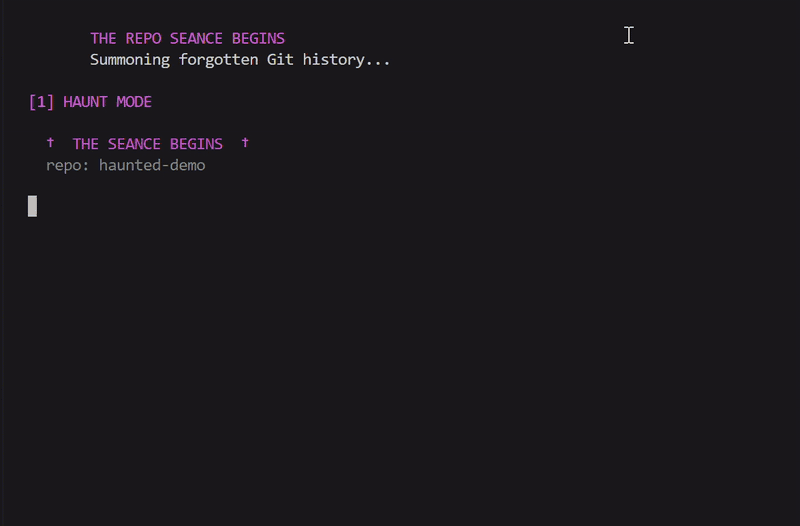

# 👻 Repo Séance

**Summon the ghosts of your Git repository.**

Repo Séance is a local AI-powered command-line tool that explores forgotten Git history and gives it a voice.

It discovers **deleted files, abandoned branches, forgotten TODOs, FIXMEs and regrettable commit messages**, then uses a locally running open-weight language model to turn these findings into contextual narratives.

By default, inference runs through [Ollama](https://ollama.com) at `localhost:11434`, keeping repository analysis and prompts on your machine.

An internet connection is required initially to install Ollama and download model weights. After setup, normal inference can run completely offline. No API key or per-request cloud service is required.

The application has no third-party Python runtime dependencies and uses Python's standard library.

[](https://drive.google.com/file/d/1rpNZSJbMA6R2OspKVyAzC9m_SgnKWGBa/view?usp=sharing)


## 🎬 Demo

See Repo Séance bring forgotten Git history back to life!

[▶️ Watch the Repo Séance Demo](https://drive.google.com/file/d/1rpNZSJbMA6R2OspKVyAzC9m_SgnKWGBa/view?usp=sharing)

The demo showcases all three modes:

- 👻 **Haunt:** Turns deleted files and abandoned branches into eerie AI-generated stories.
- 🌼 **Ofrenda:** Remembers contributors and celebrates their forgotten work.
- 🔥 **Exorcise:** Generates cleanup recommendations with grounding verification.

Powered by Qwen 2.5 3B running locally through Ollama.


```text
  †  THE SEANCE BEGINS  †
  repo: haunted

  † feature/auth-v2
    branch · 21 months dead · last seen with Ana Rivera

    feature/auth-v2 has not breathed in 21 months.
    Ana Rivera left it with the words "start oauth rewrite",
    and it is still waiting, never merged.
```

Built for the DEV **Ghost in the Machine** challenge.

Benchmark experiments and saved model outputs:
[Seance Local LLM Benchmark](https://github.com/Aarya0706/seance-local-llm-benchmark)

---

## ✨ Modes

Repo Séance has three modes, each with a different interpretation of forgotten repository history.

| Mode | Description |
|---|---|
| `haunt` 👻 | Eerie whispers with dry humor about deleted files, abandoned branches, old TODOs and questionable commits. |
| `ofrenda` 🌼 | Warm Día de los Muertos-inspired remembrances celebrating contributors and the work they left behind. |
| `exorcise` 🔥 | Generates `DELETE`, `KEEP` or `INVESTIGATE` recommendations for stale branches and old TODOs. |

### 1. Haunt Mode

The default mode. It explores forgotten repository history and transforms it into short, atmospheric stories.

```bash
python -m seance . --mode haunt
```

### 2. Ofrenda Mode

Inspired by Día de los Muertos, this mode remembers contributors through their work and the historical traces they left behind.

You can filter findings by contributor:

```bash
python -m seance . --mode ofrenda --author "ana"
```

### 3. Exorcise Mode

A practical cleanup assistant that examines old branches and TODOs and generates a suggested verdict.

```bash
python -m seance . --mode exorcise --stale-days 90
```

The available verdicts are:

- `DELETE` — consider removing the stale item.
- `KEEP` — retain it.
- `INVESTIGATE` — review it before deciding.

These are AI-generated recommendations, not automatic cleanup actions. Always review the underlying repository evidence before deleting anything.

---

## 🚀 Quick Start

### Prerequisites

- Python 3.9+
- Git
- [Ollama](https://ollama.com)

### 1. Clone the repository

```bash
git clone https://github.com/Aarya0706/repo-seance.git
cd repo-seance
```

### 2. Download a local model

For example, Qwen 2.5 3B:

```bash
ollama pull qwen2.5:3b
```

Alternatively, use Llama 3.2 3B:

```bash
ollama pull llama3.2:3b
```

### 3. Run Repo Séance

```bash
python -m seance /path/to/your/repository
```

The target must be a Git repository containing history.

### Windows Setup

Install Ollama using:

```powershell
winget install Ollama.Ollama
```

Open a new terminal after installation so that `ollama` is available in your PATH.

### Try the Haunted Demo Repository

You can generate a deliberately haunted sample Git repository to explore the experience:

```bash
python -m seance.demo ./haunted
```

Then run:

```bash
python -m seance ./haunted
```

The sample contains deliberately seeded deleted files, stale branches, abandoned TODOs and questionable commit messages.

---

## 🎮 Usage Examples

```bash
# Default spooky experience
python -m seance .

# Haunt mode
python -m seance . --mode haunt --limit 6

# Ofrenda mode for a contributor
python -m seance . --mode ofrenda --author "Ana"

# Exorcise stale branches and TODOs
python -m seance . --mode exorcise --stale-days 90

# Switch to Qwen 2.5 3B
python -m seance . --model qwen2.5:3b

# Enable factual grounding verification
python -m seance . --model llama3.2:3b --verify

# Skip the LLM and use predefined whispers
python -m seance . --no-llm
```

### Install as a CLI command

From the project root:

```bash
pip install -e .
```

Then run:

```bash
seance .
```

---

## ⚙️ Configuration

Repo Séance supports multiple configuration options.

| Flag | Description |
|---|---|
| `-m, --mode` | Select `haunt`, `ofrenda` or `exorcise`. |
| `-n, --limit` | Number of findings to summon. Default: 6. |
| `--stale-days` | Age threshold for stale branches. Default: 180 days. |
| `--author` | Filter findings by contributor name. |
| `--model` | Select the Ollama model. |
| `--host` | Configure the Ollama endpoint. |
| `--no-llm` | Use predefined whispers without model inference. |
| `--verify` | Enable grounding checks and regeneration. |
| `--retries` | Number of regeneration attempts. Default: 2. |
| `--warmup` | Load the model before timing starts. |
| `--stats-json FILE` | Save generation timings and verification results as JSON. |
| `--slow` | Enable the typewriter effect in terminal output. |

You can also configure the model and host using environment variables:

```powershell
$env:SEANCE_MODEL = "qwen2.5:3b"
$env:OLLAMA_HOST = "http://localhost:11434"
```

If Ollama is unavailable or the requested model has not been downloaded, Repo Séance falls back to predefined whispers instead of crashing.

---

## 🛡️ Grounding Verification

Small language models can produce convincing but factually incorrect descriptions.

They may invent dates, durations, commit hashes, contributor names or even incorrect merge histories.

Repo Séance includes a lightweight, rule-based grounding verification mechanism to address this.

The verifier checks generated narratives against the facts extracted from Git.

It checks:

- Durations and numerical claims.
- Dates, years and months.
- Commit hashes and unusually long tokens.
- Incorrect claims about branch merge status.
- Mentions of contributors not supported by the available facts.
- Required `VERDICT:` formatting in Exorcise mode.

Run it with:

```bash
python -m seance . --model qwen2.5:3b --verify
```

When verification is enabled, flagged responses can be regenerated up to the configured retry limit. If the output continues to contradict the available evidence, Repo Séance falls back to a predefined, fact-consistent whisper.

**Important limitation:** This is not a complete factuality evaluation. The verifier uses regular expressions and deterministic rules. It cannot establish whether vague or subjective prose is true, and some unsupported statements may still pass.

Treat verification as a useful safeguard, not a guarantee of correctness.

---

## 🧠 How It Works

The architecture follows a simple pipeline:

```text
          Git Repository
                 |
                 v
           Git History Scan
                 |
                 v
          Ghost Extraction
                 |
                 v
         Structured Findings
                 |
                 v
          Mode-Specific Prompt
                 |
                 v
        Local Ollama Inference
                 |
                 v
          Grounding Verification
                 |
          +------+------+
          |             |
       Supported     Contradiction
          |             |
          |        Regenerate /
          |        Canned Fallback
          |             |
          +------+------+
                 |
                 v
          Terminal Renderer
```

### Core Components

**1. Git History Extraction**

Python invokes Git commands to inspect repository history:

- `git log`
- `git for-each-ref`
- `git grep`
- `git blame`

These operations identify deleted files, stale branches, unfinished TODOs and suspicious commit messages.

**2. Structured Ghost Records**

Each finding is represented as a structured `Ghost` record containing information such as its type, name, author, date, last-known commit message and relevant Git details.

**3. Local LLM Narration**

The structured findings are passed to a locally running open-weight model through Ollama's `/api/generate` endpoint.

Mode-specific prompts determine whether the output should be eerie, reflective or focused on repository cleanup.

**4. Grounding Verification**

A separate Python verification layer checks generated descriptions against the extracted Git evidence.

**5. Terminal Rendering**

The results are displayed through a themed terminal interface, with different styles for each mode.

---

## 📊 Local LLM Benchmark

I created a separate benchmark repository to compare two open-weight models on repository-history storytelling.

**Models evaluated:**

- Qwen 2.5 3B
- Llama 3.2 3B

The experiments explored three dimensions:

- Runtime: Total application execution time.
- Factual grounding: Whether generated descriptions agreed with Git history.
- Writing quality: Clarity, relevance and storytelling style.

### Preliminary Results

Three runs per model on a synthetic haunted repository, with six findings generated per run:

| Model | Mean total runtime |
|---|---:|
| Qwen 2.5 3B | 50.93 seconds |
| Llama 3.2 3B | 78.50 seconds |

Qwen's mean wall-clock runtime was approximately **35.1% lower** in these three runs.

A second experiment on the MediAgent AI repository showed:

| Model | Total runtime |
|---|---:|
| Qwen 2.5 3B | 55.3 seconds |
| Llama 3.2 3B | 84.2 seconds |

This second comparison used only one run per model.

These are preliminary total application runtimes, not isolated model-inference measurements. The results depend on hardware, repository contents, warm-up, caching and run conditions.

Both models also produced factual inconsistencies in selected examples. Faster generation did not necessarily mean more reliable storytelling.

**Explore the full experiments, methodology and saved outputs:**

[Seance Local LLM Benchmark](https://github.com/Aarya0706/seance-local-llm-benchmark)

---

## 🔍 Known Limitations

- TODO scanning is text-based, so a TODO inside a string literal may also be detected.
- Age figures are approximate (months are calculated using days divided by 30).
- Findings can include real contributor names from repository history. Use Ofrenda mode responsibly when sharing output from repositories that are not yours.
- The grounding verifier catches specific, checkable contradictions but cannot guarantee factual correctness.
- Benchmark results are preliminary and should not be treated as a general model leaderboard.
- Local inference performance depends on available hardware and model size.

---

## 🧪 Tests

Run the test suite using:

```bash
python -m unittest discover -s tests -v
```

---

## 🌍 Why Open Innovation?

Open innovation is central to Repo Séance, not just a technology choice.

**Privacy:** Repository history can reveal internal implementation details, contributor activity and development decisions. Running inference locally means this information does not need to be sent to a third-party AI provider.

**Offline access:** Once Ollama and the model weights are installed, Repo Séance can run without an internet connection.

**Model freedom:** Models can be swapped with a single command-line argument, making it possible to compare different storytelling styles, response quality and factual consistency.

**Cost control:** Local inference eliminates per-request API charges, making repeated experiments and benchmarking more accessible.

**Experimentation:** Access to open-weight models made it possible to compare Qwen and Llama on the same repository-history storytelling task.

With a closed API, I would have had less control over the inference environment and model selection, and would have needed to send repository context to an external service.

Open models made it possible to build an experience that is private by default, adaptable and independently testable.

---

## 🪦 The Spirit of It

Every deleted file was once considered useful.

Every abandoned branch started with an idea.

Every TODO was a promise someone made to their future self.

We usually look at the current state of a codebase and forget the experiments, mistakes and decisions that brought it there.

Repo Séance is an attempt to bring that forgotten history back to life.

**Some code never really rests. It just waits to be summoned.** 👻

---

## 📜 License

This project is licensed under the **MIT License**. See [LICENSE](LICENSE) for details.

---

**Built with:** Python · Git · Ollama · Qwen 2.5 3B · Llama 3.2 3B

**Project:** [Aarya0706/repo-seance](https://github.com/Aarya0706/repo-seance)

**Benchmark:** [Aarya0706/seance-local-llm-benchmark](https://github.com/Aarya0706/seance-local-llm-benchmark)
